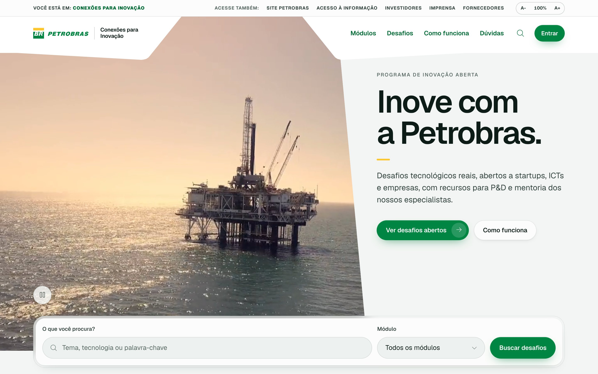
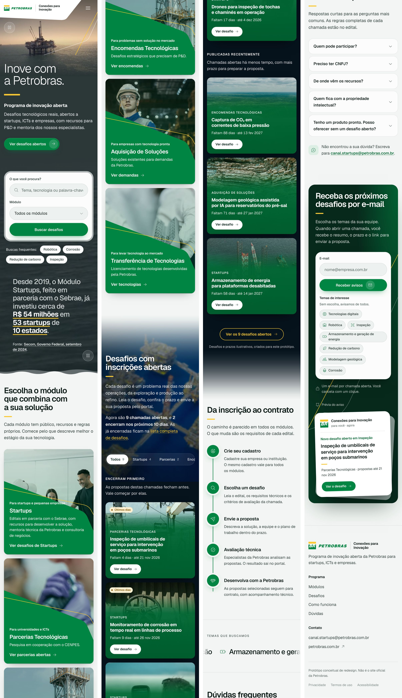
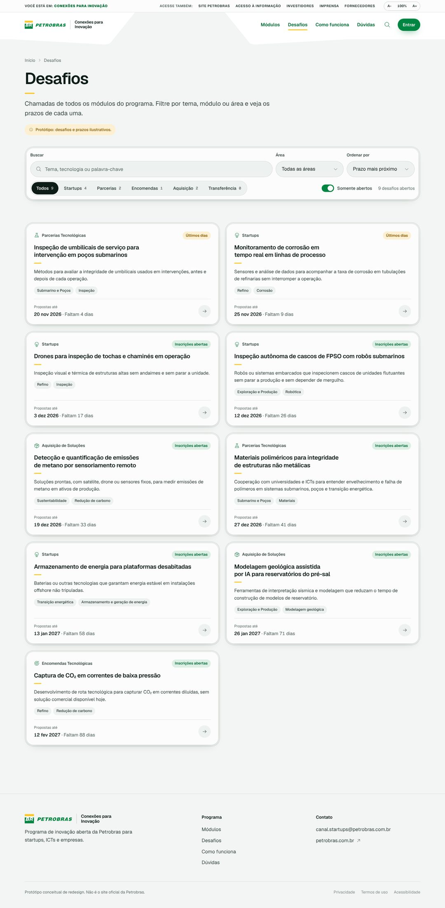
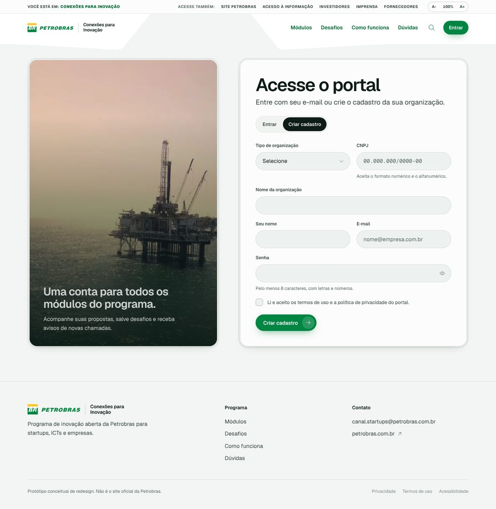

# Conexões para Inovação · protótipo de redesign

Protótipo navegável da releitura do portal [Petrobras Conexões para Inovação](https://conexoes-inovacao.petrobras.com.br/s/?language=pt_BR). É feito em HTML, CSS e JavaScript puros, sem build e sem dependências.

> Protótipo conceitual. Não é o site oficial da Petrobras. Desafios, prazos e cadastros são simulados.



## Como abrir

Sirva a pasta com qualquer servidor estático:

```bash
python3 -m http.server 8000
```

Depois abra `http://localhost:8000`.

## Páginas

| Página | Arquivo | O que mostra |
| --- | --- | --- |
| Início | `index.html` | Hero com vídeo escurecido no padrão petrobras.com.br, busca e números sobre o mar que continua do hero, módulos em cards no padrão Petrobras, vitrine escura de desafios com uma foto para cada um, no estilo do petrobras.com.br, jornada, temas, dúvidas e avisos por e-mail com escolha de temas e prévia do aviso |
| Desafios | `desafios.html` | Busca, filtros por módulo e área, ordenação, só abertos ou todos |
| Detalhe | `desafio.html?id=…` | Cabeçalho com a foto do módulo, cartão de prazo fixo com índice da página, seções numeradas, cronograma com o marcador "Hoje", documentos e outros desafios |
| Entrar | `entrar.html` | Login e cadastro com validação (CNPJ numérico e alfanumérico) |
| 404 | `404.html` | Página não encontrada |

### Estados para testar

- Carregando: qualquer lista mostra skeleton por 650 ms (simula a API).
- Vazio: [`desafios.html?q=xyz`](desafios.html?q=xyz), ou o filtro "Transferência" na home.
- Poucos desafios no módulo: filtro "Encomendas" na home (o card do desafio e, ao lado, um atalho para a lista do módulo).
- Avisos por e-mail: marque temas e veja a prévia mudar; o sucesso lista os temas escolhidos.
- Erro: [`desafios.html?simular=erro`](desafios.html?simular=erro), depois "Tentar novamente".
- Não encontrado: [`desafio.html?id=nao-existe`](desafio.html?id=nao-existe).
- Inscrição a partir de um desafio: "Enviar proposta" leva a `entrar.html?…&acao=proposta`.
- Cadastro direto: [`entrar.html?aba=cadastro`](entrar.html?aba=cadastro).
- Tema: o site é sempre claro, mesmo com o sistema em modo escuro.
- Tamanho do texto: botões A- / A+ na barra do topo (desktop). A barra tem tamanho fixo, então o controle não sai do lugar.
- Busca rápida: o ícone de lupa no header abre `desafios.html?buscar=1` com o campo em foco.
- Header: no topo da home, o header da Petrobras sobre o vídeo; ao rolar (ou com o menu aberto), a ilha flutuante. As páginas internas usam sempre a ilha.
- Vídeos: os botões de pausa do hero e do mar controlam os dois vídeos juntos.
- Movimento reduzido: ative a preferência do sistema; os vídeos não iniciam (o botão passa a "reproduzir"), as ondas e o marquee ficam parados.

## Estrutura

```
index.html, desafios.html, desafio.html, entrar.html, 404.html
assets/
  css/styles.css        tokens, base, componentes e páginas
  js/data.js            módulos, temas e desafios ilustrativos
  js/app.js             navegação, vídeos, filtros, estados, formulários
  brand/                logo oficial Petrobras (horizontal e símbolo BR)
  fonts/                Geist e Geist Mono (OFL)
  icons/phosphor/       Phosphor Icons, peso light (MIT)
  media/                vídeos do hero e do mar (MP4 e WebM), pôsteres, fotos dos módulos
  media/desafios/       uma foto por desafio
docs/screens/           capturas do protótipo
DESIGN.md               design system, análise do site petrobras.com.br e pre-flight
```

## Mídia

Os vídeos e os quadros das páginas internas vêm do arquivo `petroleo.mp4` enviado para este trabalho:

- **Vídeo do hero:** trecho de 5,5 s em vai-e-volta, sem áudio. Pesa 2,3 MB em 1600 px e 0,8 MB em 960 px. É exibido espelhado (por CSS), para a plataforma ficar à direita do texto.
- **Vídeo do mar:** recorte do mar no canto inferior direito do mesmo trecho, também em vai-e-volta. Pesa 1,1 MB em 1280 px e 0,3 MB em 640 px.
- **Pôsteres:** quadros do mesmo vídeo (hero e página de entrada). A página de cada desafio usa a foto do seu módulo.

As fotos dos cards de módulo são do [Pexels](https://www.pexels.com/license/) (uso livre, atribuição opcional; os créditos ficam aqui):

| Módulo | Foto | Autor |
| --- | --- | --- |
| Startups | [Engineers Developing Robotic Arm](https://www.pexels.com/photo/engineers-developing-robotic-arm-3913031/) | ThisIsEngineering |
| Parcerias Tecnológicas | [Scientist Working in Laboratory](https://www.pexels.com/photo/scientist-working-in-laboratory-3912482/) | ThisIsEngineering |
| Encomendas Tecnológicas | [Oil Refinery Plant](https://www.pexels.com/photo/oil-refinery-plant-15970032/) | Jakub Pabis |
| Aquisição de Soluções | [Engineer in Industrial Factory Using Tablet](https://www.pexels.com/photo/engineer-in-industrial-factory-using-tablet-32845694/) | Sergey Sergeev |
| Transferência de Tecnologias | [Peças metálicas impressas em 3D](https://www.pexels.com/photo/engineer-holding-clean-energy-battery-3861437/) | ThisIsEngineering |

O fundo da vitrine de desafios é a foto [Aerial View of Complex Platform](https://www.pexels.com/photo/aerial-view-of-complex-platform-9336590/), de Aron Razif, também do Pexels (`assets/media/vitrine-1920.webp` e `vitrine-1080.webp`).

Cada desafio também tem a sua foto (`assets/media/desafios/<id>.webp`), usada nos cards da home e no cabeçalho da página do desafio. Também são do Pexels:

| Desafio | Foto | Autor |
| --- | --- | --- |
| Inspeção autônoma de cascos de FPSO | [Offshore Oil Drillship in Türkiye's Coastal Waters](https://www.pexels.com/photo/offshore-oil-drillship-in-turkiye-s-coastal-waters-29190138/) | Faruk Yıldız |
| Materiais poliméricos | [Close-Up Shot of a Person Holding a Flask](https://www.pexels.com/photo/close-up-shot-of-a-person-holding-a-flask-9628826/) | Ivan S |
| Monitoramento de corrosão | [Valve on Industrial Pipe](https://www.pexels.com/photo/valve-on-industrial-pipe-12194246/) | David McElwee |
| Inspeção de umbilicais | [Workers on Vessel](https://www.pexels.com/photo/workers-on-vessel-15190641/) | Gustavo F. de Carvalho-Souza |
| Emissões de metano | [Pine Bend Oil Refinery](https://www.pexels.com/photo/pine-bend-oil-refinery-in-rosemount-minnesota-united-states-10407691/) | Tom Fisk |
| Armazenamento de energia | [Offshore Platform on the Sea](https://www.pexels.com/photo/offshore-platform-on-the-sea-16169309/) | Maahid Photos |
| Modelagem geológica | [Layers in a Rock Formation](https://www.pexels.com/photo/layers-in-a-rock-formation-11110872/) | Vladimir Konoplev |
| Captura de CO₂ | [Smoke from chimneys of factory](https://www.pexels.com/photo/smoke-from-chimneys-of-factory-4394351/) | K |
| Drones para inspeção | [Man Operating Underwater Camera](https://www.pexels.com/photo/man-operating-underwater-camera-12720469/) | Jordan Bergendahl |
| Catalisadores | [Person Holding Glass Flasks](https://www.pexels.com/photo/person-holding-glass-flasks-3082451/) | Chokniti Khongchum |
| Gêmeo digital | [Industrial Worker Using Tablet in Factory](https://www.pexels.com/photo/industrial-worker-using-tablet-in-factory-32845692/) | Sergey Sergeev |
| Sensoriamento por fibra óptica | [Close-Up Shot of a Green and Blue Fiber Optic](https://www.pexels.com/photo/close-up-shot-of-a-green-and-blue-fiber-optic-12932191/) | Atlantic Ambience |

Na versão final, o ideal é trocar essas fotos por imagens do banco da Petrobras (CENPES, plataformas, refinarias).

O logo oficial vem do Wikimedia Commons. A origem e as regras de uso estão em [`assets/brand/README.md`](assets/brand/README.md).

Os desafios em `assets/js/data.js` são ilustrativos. Os prazos são relativos à data de hoje, para o protótipo sempre ter chamadas abertas.

## Capturas

| Home | Mobile |
| --- | --- |
|  |  |

| Desafios | Detalhe | Cadastro |
| --- | --- | --- |
|  |  |  |
