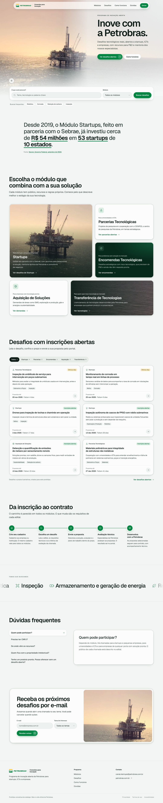
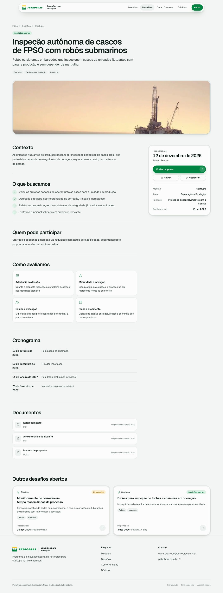

# Conexões para Inovação · protótipo de redesign

Protótipo navegável da releitura do portal [Petrobras Conexões para Inovação](https://conexoes-inovacao.petrobras.com.br/s/?language=pt_BR). É feito em HTML, CSS e JavaScript puros, sem build e sem dependências.

> Protótipo conceitual. Não é o site oficial da Petrobras. Desafios, prazos e cadastros são simulados.


## Como abrir

Sirva a pasta com qualquer servidor estático:

```bash
python3 -m http.server 8000
```

Depois abra `http://localhost:8000`.

## Páginas

| Página | Arquivo | O que mostra |
| --- | --- | --- |
| Início | `index.html` | Hero com vídeo, busca, números, módulos, desafios abertos, jornada, temas, dúvidas e avisos por e-mail |
| Desafios | `desafios.html` | Busca, filtros por módulo e área, ordenação, só abertos ou todos |
| Detalhe | `desafio.html?id=…` | Contexto, o que buscamos, critérios, cronograma, documentos e painel de inscrição |
| Entrar | `entrar.html` | Login e cadastro com validação (CNPJ numérico e alfanumérico) |
| 404 | `404.html` | Página não encontrada |

### Estados para testar

- Carregando: qualquer lista mostra skeleton por 650 ms (simula a API).
- Vazio: [`desafios.html?q=xyz`](desafios.html?q=xyz), ou o filtro "Transferência" na home.
- Erro: [`desafios.html?simular=erro`](desafios.html?simular=erro), depois "Tentar novamente".
- Não encontrado: [`desafio.html?id=nao-existe`](desafio.html?id=nao-existe).
- Inscrição a partir de um desafio: "Enviar proposta" leva a `entrar.html?…&acao=proposta`.
- Cadastro direto: [`entrar.html?aba=cadastro`](entrar.html?aba=cadastro).
- Tema: o site é sempre claro, mesmo com o sistema em modo escuro.
- Movimento reduzido: ative a preferência do sistema; o vídeo não inicia e o marquee fica parado.

## Estrutura

```
index.html, desafios.html, desafio.html, entrar.html, 404.html
assets/
  css/styles.css        tokens, base, componentes e páginas
  js/data.js            módulos, temas e desafios ilustrativos
  js/app.js             navegação, vídeo, filtros, estados, formulários
  brand/                logo oficial Petrobras (horizontal e símbolo BR)
  fonts/                Geist e Geist Mono (OFL)
  icons/phosphor/       Phosphor Icons, peso light (MIT)
  media/                vídeo do hero (MP4 e WebM), pôster e recortes
docs/screens/           capturas do protótipo
DESIGN.md               design system, decisões e pre-flight
```

## Mídia

O vídeo do hero e todas as fotos vêm do arquivo `petroleo.mp4` enviado para este trabalho:

- **Vídeo do hero:** trecho de 5,5 s em vai-e-volta, sem áudio. Pesa 2,3 MB em 1600 px e 0,8 MB em 960 px.
- **Imagens estáticas:** quadros recortados do mesmo vídeo.

O logo oficial vem do Wikimedia Commons. A origem e as regras de uso estão em [`assets/brand/README.md`](assets/brand/README.md).

Os desafios em `assets/js/data.js` são ilustrativos. Os prazos são relativos à data de hoje, para o protótipo sempre ter chamadas abertas.

## Capturas

| Home | Mobile |
| --- | --- |
|  |  |

| Desafios | Detalhe | Cadastro |
| --- | --- | --- |
|  |  |  |
